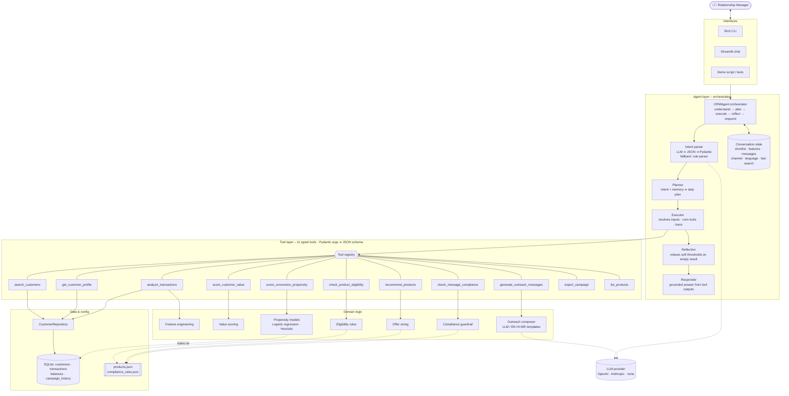
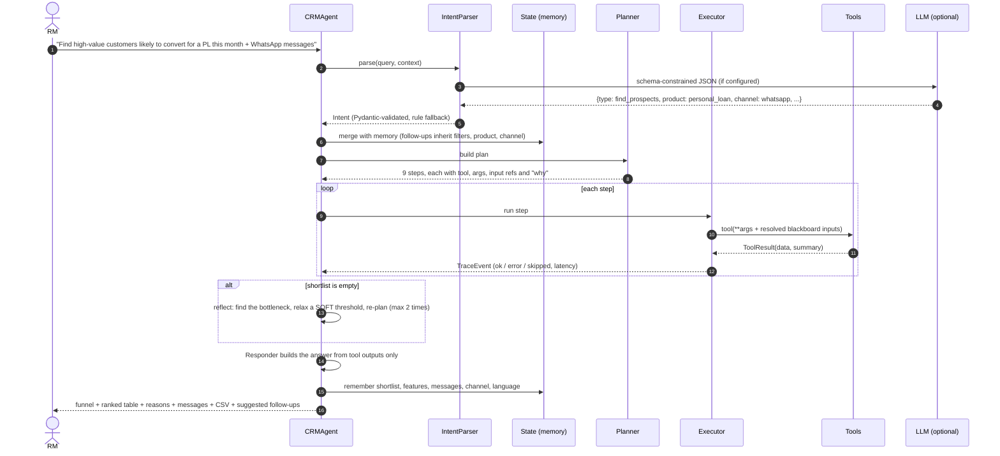

# 🏦 Agentic AI Co-pilot for Banking CRM

A **conversational, tool-using agent** that helps a bank **Relationship Manager (RM)** find high-potential customers, explain *why* they are good prospects, recommend products, and write **personalised, compliance-checked outreach** (WhatsApp / SMS / Email) in English, Hindi or Marathi.

> **RM:** *"Find high-value customers likely to convert for a personal loan this month and generate personalized WhatsApp messages."*
>
> **Agent:** plans 9 steps → scans 300 customers and 21k transactions → 119 high-value → 65 pass credit policy → ranks with an ML model (held-out AUC ≈ 0.9) → sizes an offer for each → writes 10 personalised messages → checks consent, disclaimers, banned claims and PII → re-routes 2 customers to a channel they consented to → exports a CRM-ready CSV.
> Then follow-ups work: *"only Delhi"*, *"rewrite in Hindi"*, *"send as email instead"*, *"why was Kunal Reddy selected?"*

It runs **fully offline with no API key** (rule-based intent parsing + multilingual templates). Add an OpenAI or Anthropic key and the same pipeline uses the LLM to understand requests and write messages, with automatic fallback if the LLM fails or writes something non-compliant.

🎥 **Demo video:** _add your video link here_

[](https://codespaces.new/PranavGawali14/banking-crm-agent)

> **Fastest way to try it:** click the badge above (or **Code → Codespaces → Create codespace on main**). Everything installs automatically in about 2 minutes. Then run `streamlit run src/crm_agent/interfaces/streamlit_app.py` in the terminal and click **Open in Browser**.

---

## Contents
1. [Quick start](#-quick-start)
2. [Architecture](#-architecture)
3. [Execution flow](#-execution-flow)
4. [Tool design & usage](#-tool-design--usage)
5. [How the reasoning works](#-how-the-reasoning-works-no-hard-coded-outputs)
6. [State & context handling](#-state--context-handling)
7. [Key design decisions](#-key-design-decisions)
8. [Trade-offs & limitations](#-trade-offs--limitations)
9. [Demo use cases](#-demo-use-cases)
10. [Project structure](#-project-structure)
11. [Testing](#-testing)
12. [Extending the system](#-extending-the-system)

---

## 🚀 Quick start

**Requirements:** Python 3.10+. No API key or database setup is needed; sample data is generated automatically.

### Option A: in the browser (no install)
Click **Code → Codespaces → Create codespace on main** on this repo, wait for the setup to finish, then run:
```bash
streamlit run src/crm_agent/interfaces/streamlit_app.py
```

### Option B: on your machine

**macOS / Linux**
```bash
git clone https://github.com/PranavGawali14/banking-crm-agent.git
cd banking-crm-agent
python3 -m venv .venv && source .venv/bin/activate
pip install -r requirements.txt && pip install -e .
streamlit run src/crm_agent/interfaces/streamlit_app.py
```

**Windows (PowerShell)**
```powershell
git clone https://github.com/PranavGawali14/banking-crm-agent.git
cd banking-crm-agent
python -m venv .venv
.venv\Scripts\Activate.ps1          # if blocked: Set-ExecutionPolicy -Scope CurrentUser RemoteSigned
python -m pip install -r requirements.txt
python -m pip install -e .
python -m streamlit run src/crm_agent/interfaces/streamlit_app.py
```

**VS Code:** open the folder, select the `.venv` interpreter (`Ctrl+Shift+P` → *Python: Select Interpreter*), then press **F5** and pick *Web UI*, *Chat (CLI)* or *Demo script*. Ready-made run configurations are in `.vscode/launch.json`. Tests show up in the Testing panel.

**Optional LLM:** copy `.env.example` to `.env` and add `OPENAI_API_KEY` or `ANTHROPIC_API_KEY`.

### Commands

Run these after the install above (they work the same on every OS):

| What | Command |
|---|---|
| Web chat UI (recommended) | `python -m streamlit run src/crm_agent/interfaces/streamlit_app.py` |
| Interactive chat in the terminal, with live reasoning trace | `python -m crm_agent.interfaces.cli --trace` |
| Scripted demo of all 3 use cases | `python scripts/run_demo.py --trace --save` |
| One-shot query | `python -m crm_agent.interfaces.cli -q "Top 5 credit card prospects in Pune"` |
| Run tests | `python -m pytest` |
| Regenerate synthetic data | `python -m crm_agent.data.seed --customers 500 --seed 7` |

On macOS/Linux, `make ui`, `make chat`, `make demo` and `make test` are shortcuts for the same commands.

The SQLite database (`data/crm.db`) is generated automatically on first run (≈0.3 s). The propensity model trains on first use (<1 s) and is cached in `models/`.

**CLI commands:** `/trace` (last reasoning trace) · `/state` (conversation memory) · `/tools` (tool catalogue) · `/reset` · `/quit`

A full transcript of the demo, with reasoning traces, is in [`docs/sample_run.md`](docs/sample_run.md).

---

## 🏗 Architecture



**Layers and what each one owns**

| Layer | Package | Responsibility |
|---|---|---|
| Interfaces | `crm_agent/interfaces` | CLI and Streamlit UI. They only call `CRMAgent.chat()`. |
| Orchestration | `crm_agent/agent` | Intent understanding, planning, execution, reflection, response, memory. |
| Tools | `crm_agent/tools` | Typed, self-describing capabilities with a uniform `ToolResult`. |
| Domain logic | `crm_agent/scoring`, `crm_agent/outreach` | Pure functions: features, value, eligibility, propensity, offers, messages, compliance. |
| LLM | `crm_agent/llm` | Provider-agnostic `LLMClient` (OpenAI / Anthropic / `NullLLM`) and prompts. |
| Data | `crm_agent/data`, `config/` | Repository over SQLite plus a synthetic data generator; business rules as JSON. |

---

## 🔄 Execution flow



**The prospecting plan (9 steps)**

| # | Tool | What it does | Example result |
|---|---|---|---|
| 1 | `search_customers` | SQL filter on CRM (city, segment, income, age, employment, credit score) | 300 customers |
| 2 | `analyze_transactions` | 90-day behavioural features from transactions and balances | 21,426 txns; 122 with life-event spends |
| 3 | `score_customer_value` | Value score (0–100) and tier; keep ≥ 55 | 119 high-value |
| 4 | `check_product_eligibility` | Hard credit policy, KYC, existing holdings, contact cool-down | 65 eligible (37 rejected on credit score…) |
| 5 | `score_conversion_propensity` | P(convert this month) with explanation; keep ≥ 35 %; rank | logistic model, AUC 0.9; top 10 |
| 6 | `recommend_products` | Offer amount, rate and EMI; next-best product to cross-sell | ₹16.7 L @ 11.25 %; cross-sell: credit card |
| 7 | `generate_outreach_messages` | Personalised draft per customer, channel and language | 10 WhatsApp drafts (EN / HI) |
| 8 | `check_message_compliance` | Validate, repair, regenerate or re-route | 10/10 compliant; 2 re-routed to email |
| 9 | `export_campaign` | CSV and JSON for CRM or campaign upload | `outputs/campaign_personal_loan_*.csv` |

Other intents use other recipes: **refine** (merge new filters, re-run), **generate_messages** (steps 7–9 on the remembered shortlist), **explain_customer**, **customer_profile** (customer 360 with best-fit product), **list_products**, **export**, **help**.

---

## 🧰 Tool design & usage

Every tool follows one contract (`tools/base.py`):

```python
class ScoreConversionPropensity(Tool):
    name = "score_conversion_propensity"
    description = "Estimate each customer's probability of converting on the product this month ..."

    class Args(ToolArgs):                 # Pydantic: validated input, exportable JSON schema
        customers: list[dict]
        features: dict
        product_id: str
        min_propensity: float = 0.0
        top_k: int | None = None

    def run(self, ctx: ToolContext, args: Args) -> ToolResult:
        ...
        return ToolResult(data=..., summary="Scored 65 customers with logistic:personal_loan, AUC 0.907; ...")
```

- **Typed arguments.** Bad arguments return `ToolResult(ok=False, error=...)` instead of crashing the loop. `registry.schemas()` exports OpenAI/Anthropic-compatible function schemas.
- **Dependency injection.** Tools get a `ToolContext` (repository, product config, model registry, composer, compliance checker, LLM). There are no globals, and tests can swap any dependency.
- **Uniform output.** `data` goes to the next step; `summary` is a human-readable line that becomes the reasoning trace.
- **Data passing.** Plan steps declare `inputs={"customers": "eligibility.eligible"}`. The executor resolves these dotted paths from a per-turn blackboard, so tools stay pure and reusable across recipes.
- **Failure handling.** If a step fails, later steps are marked `skipped` and the responder explains which step failed and why.

| Tool | Category | Backed by |
|---|---|---|
| `search_customers`, `get_customer_profile` | Retrieval | `CustomerRepository` (SQLite; swap for a CRM / core-banking API) |
| `analyze_transactions` | Analytics | `scoring/features.py` |
| `score_customer_value` | Decisioning | `scoring/value.py` (weighted CLV proxy) |
| `check_product_eligibility` | Policy | `scoring/eligibility.py` + `config/products.json` |
| `score_conversion_propensity` | ML | `scoring/propensity.py` (NumPy logistic regression or heuristic) |
| `recommend_products` | Next best action | `scoring/offers.py` + cross-product scoring |
| `generate_outreach_messages` | GenAI | `outreach/composer.py` (LLM or templates) |
| `check_message_compliance` | Guardrail | `outreach/compliance.py` + `config/compliance_rules.json` |
| `export_campaign` | Integration | CSV/JSON writer (stand-in for a CRM push) |
| `list_products` | Catalogue | `config/products.json` |

---

## 🧠 How the reasoning works (no hard-coded outputs)

Nothing about *who* is a good prospect is written into the agent. The synthetic data generator plants **latent life events** (wedding, travel, education, medical, home improvement, electronics) as real transactions, and labels 3,000 historical campaign outcomes using a **hidden ground-truth function**. The agent never sees that function: it has to rediscover the signals from data. A test re-seeds the database with a different seed and checks that the shortlist changes.

**1. Behavioural features** (`analyze_transactions`, last 90 days)
salary regularity · spend growth (last 30 days vs prior average) · big-ticket life-event spend in the last 45 days as a share of income (dominant event detected) · balance dip · debt-to-income from EMIs · category mix · loan-page visits in the app.

**2. Value score** (0–100): `0.35·income + 0.25·balance + 0.15·tenure + 0.10·product depth + 0.15·engagement`, all components normalised to 0–1. Tiers: Platinum ≥ 75, Gold ≥ 55, Silver ≥ 35.

**3. Eligibility** comes from `products.json` (age, income, credit score, DTI, employment type, already-held products, KYC) plus a **30-day contact cool-down** for the same product. These rules are deterministic and auditable, and the agent never relaxes them.

**4. Propensity** (Strategy pattern, `PropensityModelRegistry`):
- **Personal loan:** logistic regression trained with NumPy gradient descent on campaign history, 80/20 split. Held-out **AUC ≈ 0.9**, and it recovers the right signs (life-event spend +, DTI −).
- **Products without history** (cards, home or car loan, FD, SIP): a transparent heuristic with weights from `products.json`, normalised so that "half the positive signal" scores 50 %. This is a cold-start prior.
- Both models return **per-feature contributions**, which become the "Why now" column and the *explain* answer ("big-ticket life-event spending +1.37, spend growth +1.07 … holding back: existing EMI burden").
- Ranking: `priority = 0.7·propensity + 0.3·value`. A recent-contact fatigue factor reduces the score for customers contacted recently.

**5. Offer sizing:** loan amount = `income × multiple × DTI headroom`, capped; rate from a credit-score grid; EMI calculated for 36 months. Card limit, FD rate (with senior bonus) and SIP amount follow the same pattern.

**6. Personalised outreach:** the composer gets a **sanitised brief** (first name, tier, tenure, offer, segment-based formality, preferred language and a *generic need hint* such as "may be planning celebrations"). It **never sees raw transactions**, so a message can't say "we saw you spent ₹2 L at a jeweller". Personalisation varies by name, salutation (formal for Wealth/Priority), tenure, tier, offer numbers, language (EN/HI/MR offline; any language with an LLM), channel format and the strongest behavioural signal. The tests check that no two messages are identical.

**7. Compliance loop** (generate → validate → repair):
| Check | Action |
|---|---|
| Consent per channel, DND blocks SMS | Re-route to a consented channel, or block |
| Banned claims ("guaranteed approval", "no documents" …) | Regenerate from the approved template |
| PII / transaction leakage (account numbers, PAN, "you spent ₹…") | Regenerate from the approved template |
| Missing disclaimer or opt-out text | Auto-append |
| Channel length limit | Regenerate |

**8. Reflection.** If the shortlist is empty, the agent finds the stage that emptied it and relaxes one **soft** business threshold (value cut-off, minimum propensity), re-plans (at most twice) and tells the RM exactly what it changed. Example: *"No customers passed the high-value cut-off (55); relaxed it to 40 and re-ran the plan."*

---

## 🗂 State & context handling

| Scope | Where | Holds | Enables |
|---|---|---|---|
| **Per step** | Blackboard dict | Tool outputs for this plan | Data flow between steps through declared inputs |
| **Per session** | `ConversationState` (Pydantic) | Last search intent, shortlist, features, messages, product, channel, language, funnel, last trace, bounded turn history (40) | Follow-ups: *"only Pune"*, *"top 3"*, *"in Hindi"*, *"as email"*, *"why Priya?"*, *"export"* |
| **Persistent** | `.sessions/<id>.json` | The serialised state | Resume with `--session <id>` |

`Planner.resolve()` fills missing slots from memory. A *refine* request merges new filters into the previous search (`CustomerFilters.merged_with`). A *generate_messages* request reuses the remembered shortlist without re-scoring. Name references resolve against the current shortlist first, and if a name is ambiguous ("Kunal" matches two customers) the agent asks which one instead of guessing. The LLM gets only a **compact, PII-light context summary** (first names, last filters, channel, language).

---

## ⚖️ Key design decisions

| Decision | Why |
|---|---|
| **The LLM understands, a deterministic planner plans** (not a free-form ReAct loop) | In a regulated bank the same question should produce the same tool sequence. Plans are auditable, testable and cheap. The LLM is used where it adds most value: language understanding and copywriting. |
| **Every capability is a typed tool** | Clear separation, JSON schemas ready for function calling, independent unit tests, and new tools plug in without touching the agent. |
| **Credit policy is rules, never LLM** | Eligibility must be explainable to auditors and regulators. Only *soft* heuristics are relaxed by reflection. |
| **Explainable ML** (logistic regression with contributions) instead of a black box | Model-risk governance: every score comes with reasons the RM can say out loud. AUC is reported every time. |
| **Strategy pattern for propensity** | Products with history use ML, cold-start products use a heuristic, and either can be swapped for XGBoost or a served model without changing callers. |
| **Sanitised brief for message generation** | Personalisation without creepiness and without leaking data into prompts. |
| **Compliance as a separate critic tool** | Generation and validation are decoupled: LLM drafts are never trusted blindly, and repairs and re-routes are recorded in the trace. |
| **Offline-first with graceful degradation** | Evaluators can run it with zero keys. LLM outages, timeouts or bad JSON fall back to rules and templates, and this is tested. |
| **Repository pattern over SQLite** | Swap in Salesforce FSC, Dynamics, Finacle or a data warehouse by changing one class. |
| **Config-driven products and compliance** (`config/*.json`) | Business teams can change thresholds, rates, banned phrases and disclaimers without code changes. |

---

## 🧩 Trade-offs & limitations

**Trade-offs made**
- **Deterministic recipes vs. open-ended autonomy.** More reliable and auditable, but the agent can't invent a brand-new workflow. Unsupported requests get help text. *Mitigation:* tool schemas are already exported, so an LLM tool-calling planner can be added for exploratory questions while keeping recipes for regulated flows.
- **Rule parser vs. LLM parser.** The offline parser handles the documented phrasings (products, cities, income/age/credit filters, top-k, channel, language, follow-ups) but not arbitrary paraphrases. With an LLM configured, coverage is much broader and outputs are still schema-validated and guard-railed (e.g. hallucinated cities or products are dropped).
- **Templates vs. LLM copy.** Templates are safe, instant and free, but less varied, and offline they only cover EN/HI/MR. The LLM is more natural and supports any language, at the cost of latency, money and needing the compliance loop.
- **Logistic regression vs. gradient boosting.** Slightly lower accuracy ceiling, but fully explainable, dependency-free and fast.
- **Re-running the pipeline on refine vs. filtering the cached shortlist.** This is correct when filters widen the population and costs only about 0.2 s here; at bank scale I'd cache features in a feature store.

**Limitations**
- **Data is synthetic.** Distributions are plausible, but the propensity model learns a simulated behaviour. Real deployment needs real campaign outcomes, calibration and drift monitoring.
- "**This month**" is approximated by recency-weighted signals (30–45-day windows), contact cool-down and fatigue. There is no explicit time-to-event model.
- **Heuristic scores for non-PL products are uncalibrated priors** until campaign outcomes for those products exist.
- **No real message sending.** Output is a CRM-ready CSV/JSON. WhatsApp Business templates would need pre-approval by Meta, and DLT registration is required for SMS in India.
- **Single-user, in-process state.** Production would use Redis or Postgres for sessions, with authentication and row-level access (each RM sees only their book).
- **Hindi/Marathi templates are hand-written.** They should be reviewed by native-speaking compliance staff.
- **Message evaluation is rule-based** (compliance plus uniqueness). There is no human or LLM-as-judge quality scoring yet.

---

## 🎬 Demo use cases

`python scripts/run_demo.py --trace --save` runs all of these. See [`docs/DEMO_SCRIPT.md`](docs/DEMO_SCRIPT.md) for a minute-by-minute video script.

| # | Conversation | Shows |
|---|---|---|
| **1** | *"Find high-value customers likely to convert for a personal loan this month and generate personalized WhatsApp messages."* → *"Only show the ones in Delhi or Mumbai"* → *"Rewrite the messages in Hindi"* → *"Why was Kunal Reddy selected?"* | Full 9-step plan, ML ranking, consent re-routing, refine with memory, multilingual regeneration, explainability |
| **2** | *"Which salaried customers should get a credit card upgrade? Top 5"* → *"Send them as email instead"* → *"Export this campaign"* | A different product with the heuristic model, signal-specific hooks (dining/travel/shopping), channel switch, export |
| **3** | *"Tell me about C0042"* → *"Find fixed deposit prospects among retirees in Chennai and draft SMS messages"* → *"What products do we have?"* | Customer 360 with best-fit product, **reflection** relaxing thresholds, DND-aware SMS, catalogue |

**Example output (offline mode)**

| # | Customer | City | Value | Propensity | Why now | Offer | Next best |
|---|---|---|---|---|---|---|---|
| 1 | Kunal Reddy (C0048) | Delhi | Platinum (80) | 86% | recent jump in spending, browsed loan pages in the app | ₹40,00,000 @ 11.25% | Signature Rewards Credit Card |
| 2 | Zoya Rao (C0057) | Delhi | Gold (69) | 90% | big-ticket life-event spending, recent jump in spending | ₹16,70,000 @ 11.25% | Signature Rewards Credit Card |

```text
नमस्ते Zoya जी 🙏

11 साल से NovaBank के साथ बने रहने के लिए धन्यवाद! हमारे Gold ग्राहक होने के नाते, आपके लिए ₹16,70,000 तक का
प्री-अप्रूव्ड पर्सनल लोन उपलब्ध है — सांकेतिक ब्याज दर 11.25% प्रति वर्ष (36 महीनों के लिए EMI लगभग ₹54,872/माह)।

कोई बड़ा अपग्रेड प्लान कर रहे हैं? खर्च को आसान EMI में बांटें।

डिटेल्स के लिए YES लिखकर भेजें — पैसा उसी दिन आपके खाते में आ सकता है।

– Ananya Iyer, रिलेशनशिप मैनेजर, NovaBank

*T&C apply. Subject to credit approval. Reply STOP to opt out.
```

(Zoya prefers Hindi, so the agent wrote in Hindi automatically. The "big upgrade" hook comes from detected electronics spending, but the message never mentions the purchase.)

---

## 📁 Project structure

```
banking-crm-agent/
├── README.md
├── requirements.txt · pyproject.toml · Makefile · .env.example · LICENSE
├── .devcontainer/                # one-click GitHub Codespaces setup
├── .vscode/                      # F5 run configurations + test settings
├── config/
│   ├── products.json             # catalogue: eligibility, offer rules, propensity signal weights, hooks
│   └── compliance_rules.json     # channels, consent, banned phrases, disclaimers, PII patterns
├── src/crm_agent/
│   ├── config.py                 # all settings (env-overridable)
│   ├── models.py                 # Pydantic contracts: Intent, Plan, PlanStep, ToolResult, TraceEvent, OutreachMessage…
│   ├── agent/                    # ── orchestration
│   │   ├── orchestrator.py       #   CRMAgent: understand → plan → execute → reflect → respond → remember
│   │   ├── intent.py             #   LLM intent parser + rule-based fallback
│   │   ├── planner.py            #   intent + memory → step plan (task recipes)
│   │   ├── executor.py           #   runs steps, resolves inputs, records trace
│   │   ├── responder.py          #   grounded markdown answers
│   │   └── state.py              #   conversation memory + persistence
│   ├── tools/                    # ── tool layer
│   │   ├── base.py               #   Tool, ToolArgs, ToolContext, ToolRegistry
│   │   ├── crm_tools.py          #   search, profile, transaction analytics
│   │   ├── scoring_tools.py      #   value, eligibility, propensity, recommendation, catalogue
│   │   └── outreach_tools.py     #   message generation, compliance, export
│   ├── scoring/                  # ── domain logic (pure functions)
│   │   ├── features.py · value.py · eligibility.py · propensity.py · offers.py
│   ├── outreach/
│   │   ├── composer.py           #   LLM / template composer with sanitised brief
│   │   ├── templates.py          #   EN · HI · MR building blocks, INR formatting
│   │   └── compliance.py         #   guardrail checker
│   ├── llm/                      # provider-agnostic client, OpenAI / Anthropic, prompts
│   ├── data/                     # repository + synthetic data generator
│   └── interfaces/               # cli.py · streamlit_app.py
├── scripts/run_demo.py           # 3 scripted use cases → docs/sample_run.md
├── docs/
│   ├── DEMO_SCRIPT.md            # video walkthrough script
│   └── sample_run.md             # full transcript with reasoning traces
└── tests/                        # 32 tests: data, features, scoring, intent, tools, compliance, e2e, LLM path
```

---

## ✅ Testing

```bash
python -m pytest          # 32 tests, about 2 s, no network
```

The suite covers reproducible seeding, bounded features, life-event detection, eligibility rules, the logistic model learning the hidden signal (AUC > 0.75, correct coefficient signs), heuristic monotonicity, offer and EMI maths, intent slot extraction and follow-ups, compliance (banned claims, PII, disclaimers, DND and consent), tool argument validation, JSON schemas, the end-to-end 9-step plan, multi-turn memory, reflection, a **"results depend on data, not hard-coding"** re-seed test, and the **LLM path with a fake client** (schema-validated intents, hallucination guardrails, unsafe-draft regeneration, outage fallback).

---

## 🔌 Extending the system

| To add… | Do this |
|---|---|
| A new product | Add an entry in `config/products.json` (aliases, eligibility, offer, signals, hooks). The parser, eligibility, heuristic model, offers and messages pick it up automatically. |
| An ML model for that product | Add rows to `campaign_history`. The registry trains a logistic model once ≥ 200 outcomes exist. |
| A new tool (e.g. `check_credit_bureau`, `book_meeting`) | Subclass `Tool` with an `Args` model, register it in `tools/__init__.py`, and reference it in a planner recipe. |
| A real CRM or core banking system | Re-implement `CustomerRepository` methods against the API. |
| A new channel (RCS, push) | Add it to `compliance_rules.json` and `CHANNEL_RULES`. |
| An LLM tool-calling planner | Pass `registry.schemas()` to the model. Executor, tracing and guardrails are reused. |
| Production hardening | Redis sessions, auth / RM-book scoping, feature store, MLflow model registry, observability (OpenTelemetry on `TraceEvent`), WhatsApp Business / DLT gateways. |
